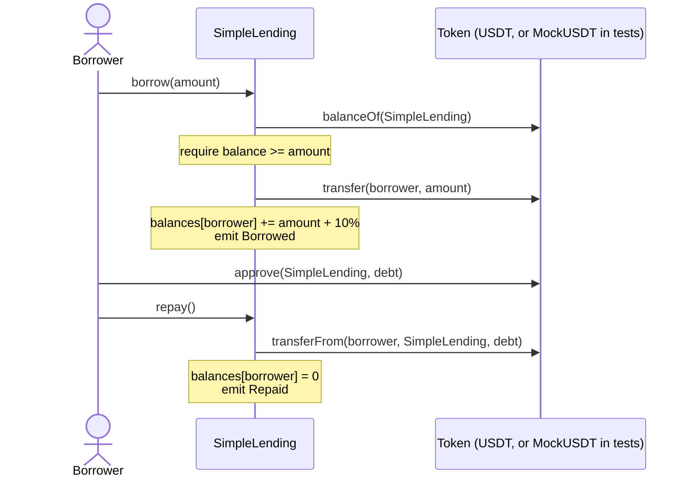

# Web3 Solidity Algo

A USDT lending contract in Solidity with a Hardhat test suite, plus a Python
word-pair solver. These are my answers to Part 2 of a coding test from
January 2024.

[](https://github.com/tahmidbintaslim/Web3-Solidity-Algo/actions/workflows/ci.yml)
[](LICENSE)

> **Coding exercise, not production code.** The contract has not been
> audited, has no collateral or borrowing limit, and does not work with the
> real mainnet USDT token (see [Status](#status)). It is not deployed
> anywhere, so there is no live demo.

- **2.1 Word pair:** `solve(wordList, target)` returns two words from the list
  that concatenate to `target`, or `None`.
- **2.2 Lending:** `SimpleLending` lends a token with a fixed 10% interest.
  `borrow(amount)` sends tokens and records the debt; `repay()` collects the
  debt in one `transferFrom`.

The original brief is at the [end of this file](#assignment-brief).

## Contents

- [Features](#features)
- [Tech stack](#tech-stack)
- [How the contract works](#how-the-contract-works)
- [Getting started](#getting-started)
- [Deployment](#deployment)
- [Project structure](#project-structure)
- [Status](#status)
- [Contributing](#contributing)
- [License](#license)
- [Assignment brief](#assignment-brief)

## Features

**2.2 Solidity lending** (`Task_2_2_Solidity_Lending/`)

- `borrow(uint256 amount)` checks that the contract holds at least `amount`,
  transfers `amount` to the caller, and adds `amount` plus 10% to the caller's
  debt in `balances`. A second loan adds to the existing debt.
- `repay()` reverts with `No debt to repay` when the caller owes nothing.
  Otherwise it pulls the whole debt with `transferFrom` (the caller approves
  the contract first) and sets the debt to zero.
- Both functions emit an event: `Borrowed(borrower, amount)` and
  `Repaid(borrower, amount)`.
- `MockUSDT` is an OpenZeppelin ERC-20 with 6 decimals, used in place of USDT
  in the tests.
- 11 Hardhat unit tests covering setup, borrowing, repaying, both events and
  the three revert paths. `npx hardhat coverage` reports 100% of lines and
  branches in both contracts.
- `scripts/deploy.js` deploys `SimpleLending` with the mainnet USDT address
  (to the in-process Hardhat network by default).

**2.1 Word pair** (`Task_2_1_Algorithm_Programming/`)

- `solve` checks every ordered pair of list positions `(i, j)` with `i != j`
  and returns the first pair whose concatenation equals `target`. It is a
  brute-force O(n²) search.
- 7 `unittest` cases: the four examples from the brief, plus an empty list,
  pair order, and no self-pairing at one position.

## Tech stack

| Area | Tools |
| --- | --- |
| Contracts | Solidity `^0.8.16`, compiled with solc 0.8.20; OpenZeppelin Contracts 5 (`ERC20` for the mock) |
| Framework | Hardhat 2.29 with `@nomicfoundation/hardhat-toolbox` 4 (ethers v6, Mocha, Chai matchers, solidity-coverage, gas reporter) |
| Algorithm | Python 3, standard library only (`unittest` for tests) |
| CI | GitHub Actions: Hardhat job on Node 22 and 24, Python job on 3.13 |

## How the contract works



The interest is fixed: 10% of each loan, whatever the time between `borrow`
and `repay`. A borrower only receives `amount`, so they need the extra 10%
from somewhere else before `repay()` can succeed. The tests transfer it to
them first.

## Getting started

### Prerequisites

- Node.js 22 or 24 (Hardhat 2.29 supports 20, 22 and 24; CI runs 22 and 24)
- npm 7 or newer for the v3 lockfile (tested with npm 10.9)
- Python 3 (CI uses 3.13; tested locally with 3.13)
- Internet access on the first compile: Hardhat downloads the Solidity
  compiler

No environment variables are needed. `hardhat.config.js` defines no external
networks, RPC URLs or keys, so there is no `.env` file to create.

### Clone

```shell
git clone https://github.com/tahmidbintaslim/Web3-Solidity-Algo.git
cd Web3-Solidity-Algo
```

### Lending contract

```shell
cd Task_2_2_Solidity_Lending
npm ci                       # install the exact versions in package-lock.json
npx hardhat compile          # or: npm run compile
npx hardhat test             # or: npm test
npx hardhat coverage         # or: npm run coverage (writes ./coverage/)
REPORT_GAS=true npx hardhat test   # per-method gas table
npx hardhat run scripts/deploy.js  # or: npm run deploy:local
```

`npx hardhat test` prints:

```
  SimpleLending
    Deployment
      ✔ stores the token address and starts with the 10M pool
      ✔ uses a mock token with 6 decimals, like USDT
    Borrowing
      ✔ should allow a user to borrow USDT
      ✔ should record the debt with interest
      ✔ adds a second loan to the existing debt
      ✔ emits Borrowed with the borrower and the amount
      ✔ reverts when the contract holds less than the amount
    Repaying
      ✔ should allow a user to repay the borrowed USDT with interest
      ✔ emits Repaid with the borrower and the amount owed
      ✔ reverts when the caller has no debt
      ✔ reverts when the caller has not approved the full debt


  11 passing
```

### Word pair

From the repository root:

```shell
python3 Task_2_1_Algorithm_Programming/task2_1.py
python3 -m unittest discover -s Task_2_1_Algorithm_Programming -v
```

The script prints the four results from the brief:

```
('ab', 'cd')
('cd', 'ab')
None
('ab', 'ab')
```

A word is never paired with itself at the same position. A target made of one
word twice is found only when that word appears twice in the list, as in
example 4; `solve(["ab"], "abab")` returns `None`.

## Deployment

Nothing is deployed. `npx hardhat run scripts/deploy.js` deploys
`SimpleLending` to the in-process Hardhat network, prints the address and
exits; CI runs it as a smoke test. The script passes the mainnet USDT address
(`0xdAC17F958D2ee523a2206206994597C13D831ec7`) to the constructor, but
`hardhat.config.js` has no mainnet or testnet network, and the contract should
not go to mainnet as written (see [Status](#status)).

## Project structure

```
.
├── .github/
│   ├── workflows/ci.yml         # Hardhat and Python jobs
│   ├── dependabot.yml           # weekly npm and Actions updates
│   └── ISSUE_TEMPLATE/          # Sweep AI issue template
├── Task_2_1_Algorithm_Programming/
│   ├── task2_1.py               # solve(wordList, target) and the brief's examples
│   └── test_task2_1.py          # unittest cases
├── Task_2_2_Solidity_Lending/
│   ├── contracts/
│   │   ├── SimpleLending.sol    # borrow(uint256), repay()
│   │   └── MockUSDT.sol         # 6-decimal ERC-20 for tests
│   ├── scripts/deploy.js
│   ├── test/SimpleLending.test.js
│   ├── hardhat.config.js        # solc 0.8.16 and 0.8.20, no networks
│   └── package.json             # npm scripts and security overrides
├── sweep.yaml                   # Sweep AI app config
└── LICENSE
```

`sweep.yaml` and `.github/ISSUE_TEMPLATE/` belong to the Sweep AI GitHub app.
`sweep-ai[bot]` committed both on the `sweep/add-sweep-config` branch in
January 2024; they reached `main` when PR #1 was merged in December 2025.

## Status

Finished coding exercise, kept for reference. Checked on 2026-10-26 from a
clean clone with `npm ci`:

- The Python script prints the expected results, and its 7 unit tests pass.
- The contracts compile. Hardhat builds them with solc 0.8.20, the newest
  compiler in `hardhat.config.js` that satisfies `pragma ^0.8.16`, not the
  0.8.16 the brief named. The OpenZeppelin 5 `ERC20` imported by `MockUSDT`
  needs `^0.8.20`.
- The 11 Hardhat tests pass, and `scripts/deploy.js` deploys to the
  in-process Hardhat network. Until October 2026 the tests and the deploy
  script used ethers v5 calls (`contract.address`, `deployed()`) and failed
  under the ethers v6 that hardhat-toolbox 4 installs; the repay test also
  never gave the borrower the 10% interest it had to pay back.

Known limitations of the contract, kept as written for the exercise:

- It does not work with the real USDT. Its own `IERC20` interface expects
  `transfer` and `transferFrom` to return a `bool`; mainnet USDT returns
  nothing, so `borrow` and `repay` would revert. The return values are not
  checked either. Only the mock token has been used, and there is no mainnet
  fork test.
- There is no collateral or borrowing limit. Any address can borrow the whole
  balance, and nothing makes it repay.
- `owner` is set in the constructor and never used.

If this were taken further, the next steps would be OpenZeppelin `SafeERC20`
for the transfers, a mainnet fork test against the real USDT, and collateral
or a per-borrower limit. None of these is planned.

## Contributing

This is a finished exercise, so new features are unlikely to be merged.
Issues and fixes are welcome. Before opening a pull request, run
`npx hardhat test` in `Task_2_2_Solidity_Lending/` and the Python tests from
the root; CI runs both.

## License

GPL-3.0. See [LICENSE](LICENSE). The two `.sol` files carry an
`SPDX-License-Identifier: MIT` header.

## Assignment brief

Part 2 had two parts, and the brief invited improvements beyond the stated
requirements.

### 2.1 Algorithm programming

Write a function `solve(wordList, target)` in Python 3 to solve the following
problem.

- Input: a list of distinct strings `wordList`, and a target word `target`.
- Output: return 2 words (not necessarily distinct) that, concatenated, form
  the target word. Any pair is fine if multiple solutions exist. If no pair
  exists, return `None`.

Examples:

1. `wordList = ["ab", "bc", "cd"]`, `target = "abcd"` ⇒ `("ab", "cd")` or `("cd", "ab")`
2. `wordList = ["ab", "bc", "cd"]`, `target = "cdab"` ⇒ `("ab", "cd")` or `("cd", "ab")`
3. `wordList = ["ab", "bc", "cd"]`, `target = "abab"` ⇒ `None`
4. `wordList = ["ab", "ba", "ab"]`, `target = "abab"` ⇒ `("ab", "ab")`

### 2.2 Solidity lending

Write a simple lending contract on USDT in Solidity 0.8.16 on Ethereum
mainnet. USDT contract address: `0xdAC17F958D2ee523a2206206994597C13D831ec7`.

- Assume the contract will initially hold 10 million USDT (someone will
  transfer it).
- Two main functions:
  - `borrow(uint amount)`: the caller borrows `amount` USDT from the contract.
  - `repay()`: the caller repays the borrowed amount plus 10% interest (fixed
    for any period of time).

Any Solidity framework may be used, for example Brownie, Hardhat, Truffle or
Forge.
Include the contract and tests (unit tests and/or a fork test script).
